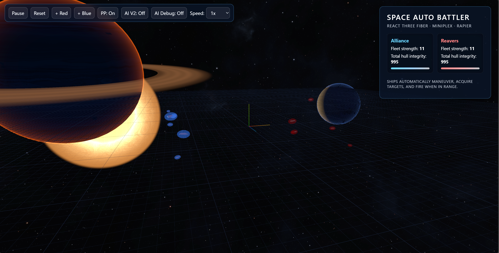

# SpaceAutoBattler



SpaceAutoBattler is a lightweight, research-oriented 3D space combat simulator. The project separates deterministic simulation logic (pure game logic under `src/game`) from rendering and UI (`src/components`, `App.tsx`) so you can run headless tests and fast experiments.

## Tech stack

- TypeScript + React 19
- Rendering: React Three Fiber (`@react-three/fiber`) + Drei + Three.js
- Physics: Rapier (`@dimforge/rapier3d-compat`)
- ECS: Miniplex
- UI state: Zustand
- Tooling: Vite via vite-plus (`vp`), with oxlint/oxfmt (`vp lint` / `vp fmt`)
- Tests: Vitest (unit/integration) and Playwright (E2E/visual)

## Quick start

Clone, install dependencies, then either run the dev server (fast feedback) or build and serve the production bundle:

```bash
git clone https://github.com/deadronos/SpaceAutoBattler.git
cd SpaceAutoBattler
pnpm install

# Development (Vite dev server)
pnpm run dev

# Build a production bundle (Vite -> `dist/`)
pnpm run build

# Preview the built files (serves `./dist` on :8080)
pnpm run preview
```

Open the local server at <http://localhost:8080> (or the URL printed by the serve script).

### Documentation

- **Architecture Overview**: [`docs/high-level-architecture.md`](docs/high-level-architecture.md) — High-level system design, architectural principles, directory structure, core concepts, and data flow patterns
- **Source Structure**: [`spec/src-structure.md`](spec/src-structure.md) — Detailed file-by-file breakdown of the `src/` directory
- **Motion System**: [`spec/spec-physical-movement.md`](spec/spec-physical-movement.md) — Deterministic ship movement, renderer interpolation, and banking behavior specifications
- **Inline Documentation**: Many core modules include JSDoc comments. Hover over symbols in your IDE to see usage details, parameters, and return types.

## Project layout

Edit TypeScript sources in `src/` only. Key folders:

- `src/main.tsx` — App bootstrap and renderer mounting
- `src/App.tsx` — React top-level application component
- `src/game/` — pure game logic: state container, systems, and ship blueprints
- `src/components/` — React / R3F components for rendering (Ship, Projectile, HUD)
- `src/types/` — canonical types including `GameState` (single source of runtime state types)
- `src/utils/` — seeded RNG and shared helpers
- `src/data/` — data tables (for example ship stats)
- `src/worker/` — optional worker-simulation protocol and transforms layout helpers
- `src/styles/` and `spaceautobattler.html` — global styles and HTML entry points

Build artifacts and generated files live in `dist/` (do not edit).

## Scripts & common commands

The project provides a set of pnpm scripts to run tests, checks and builds. Common ones:

- `pnpm install` — install dependencies
- `pnpm run dev` — Vite dev server on port 8080
- `pnpm start` — alias for `pnpm run dev`
- `pnpm run build` — production Vite build (runs `prebuild` first)
- `pnpm run build:dev` — development build (`vite build --mode development`)
- `pnpm run preview` — serve `./dist` on port 8080
- `pnpm run serve` — alias for `pnpm run preview`
- `pnpm run serve:e2e` — serves `dist/` + repository root for Playwright pages
- `pnpm test` — run unit tests (Vitest, node/happy-dom environment)
- `pnpm run test:e2e` — run Playwright end-to-end tests
- `pnpm run typecheck` — TypeScript typecheck (no emit)
- `pnpm run lint` — oxlint via vite-plus (`vp lint`, source files)
- `pnpm run lint:fix` — oxlint with autofix (`vp lint --fix`)
- `pnpm run format` — oxfmt formatting (`vp fmt . --write`)

There are also utility scripts used by the project lifecycle:

- `pnpm run prebuild` — runs a project-specific check (no sync reads) before building
- `pnpm run check-no-sync-reads` — detection script used by `prebuild`

Use `pnpm run` to list all scripts.

## Testing

Unit tests live under `test/` (logic-focused, deterministic): Vitest includes all `test/**/*.spec.ts` except `test/playwright/**` (see `vite.config.ts`). Playwright tests live under `test/playwright/` and test artifacts appear in `test-output/` and `playwright-report/` when run.

Recommended quick checks before committing:

```bash
pnpm run typecheck && pnpm test
```

## Codebase notes

- Keep edits confined to `src/` (TypeScript). Do not edit files under `dist/` — they are build artifacts.
- Canonical runtime state: use the `GameState` type defined in `src/types/index.ts` for all simulation state.
- Determinism: runtime randomness is provided by the seeded RNG in `src/utils/rng.ts`; do not introduce nondeterministic behavior in simulation codepaths.
- Configuration-driven design: most gameplay and rendering parameters live under `src/config/`. Prefer editing config over hardcoding values.

Proposed small improvements (low-risk):

1. Add `docs/_index.md` or expand `llms.txt` with brief file summaries for discoverability.
2. Add a CI link-check job to validate README and docs links.
3. Add a lightweight API audit that exposes minimal test helpers for external tooling.

## Deployment

This project is configured to automatically deploy to GitHub Pages when a new tag is created (e.g., for releases).

### Initial Setup

Repository owners need to enable GitHub Pages:

1. Go to repository Settings → Pages
2. Set Source to "GitHub Actions"
3. No additional configuration needed

### Deployment Process

1. **Automatic deployment**: Push a git tag (e.g., `v1.0.0`) to trigger the GitHub Actions workflow
2. **Quality gates**: A version guard asserts the release tag matches `package.json` `"version"`, then the workflow runs `vp run typecheck`, `vp check`, `vp test`, and `vp build` before building
3. **Build and deploy**: Creates a production build and deploys to GitHub Pages
4. **File handling**: Automatically copies `spaceautobattler.html` to `index.html` for proper GitHub Pages routing

To create a release deployment:

```bash
git tag v1.0.0
git push origin v1.0.0
```

The site will be available at `https://[username].github.io/SpaceAutoBattler/` after deployment completes.

### Compression

Production builds generate pre-compressed versions of eligible assets (`.gz` and `.br`). Whether clients
receive these depends on your hosting/CDN configuration.

See [`docs/compression.md`](docs/compression.md) for detailed compression ratios and configuration.

### Local Testing

Test the deployment build process locally:

```bash
pnpm run build:deploy
pnpm run serve
```

Verify compression is working on the deployed site:

```bash
node scripts/verify-compression.mjs
```

## Contributing

Fork the repository, create a feature branch, add tests, and open a pull request. Follow these rules:

- Edit TypeScript only under `src/` (do not modify build artifacts in `dist/`).
- Preserve deterministic behavior: use the seeded RNG and `GameState` for runtime state.
- Add unit tests under `test/` (excluding `test/playwright/`) for logic changes and update `test/playwright/` for UI flows when relevant.
- Run `pnpm run typecheck` and `pnpm test` before opening a PR.

## License

MIT — see `LICENSE.MD`.
